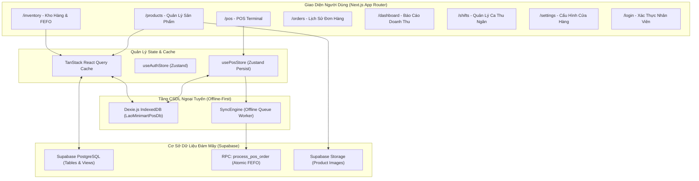

# BỘ NHỚ BÀN GIAO TOÀN DIỆN HỆ THỐNG (PROJECT HANDOFF CONTEXT)
> **Tài liệu bàn giao kiến trúc kỹ thuật & nghiệp vụ lõi (Living Architectural & Business Memory)**  
> **Dự án:** Minimart POS & Management System (Lao Chaleun Minimart - ມິນິມາດ ລາວຈະເລີນ)  
> **Phiên bản:** 0.1.0 (Production-Ready Architecture)  
> **Mục tiêu:** Cung cấp đầy đủ bối cảnh hệ thống cho AI Assistant và Kỹ sư phát triển mới. Khi bắt đầu một phiên chat mới, chỉ cần tham chiếu tài liệu này là có thể nắm bắt 100% logic, kiến trúc, data flow và các bất biến nghiệp vụ (Core Invariants) mà không làm phá vỡ logic cũ.

---

## 1. TỔNG QUAN HỆ THỐNG & TECH STACK

### 1.1. Mục tiêu Nghiệp vụ
Hệ thống phần mềm Quản lý Bán lẻ & POS chuyên sâu cho mô hình Minimart / Cửa hàng tiện lợi tại thị trường Lào. Hỗ trợ đầy đủ:
- **Ngôn ngữ chuẩn:** Tiếng Lào (`ພາສາລາວ`) là ngôn ngữ giao diện chính 100% cho người dùng cuối (Thu ngân, Chủ cửa hàng, Quản lý kho). Tiếng Anh (`English`) được hỗ trợ làm ngôn ngữ phụ trong tên sản phẩm và tài liệu kỹ thuật.
- **Tiền tệ:** Kíp Lào (`LAK` - `₭`). Định dạng chuẩn: dấu chấm `.` làm phân cách hàng nghìn (ví dụ: `16.000 ₭`, không dùng dấu phẩy, không có phần thập phân). Hỗ trợ các mệnh giá tiền mặt Kíp phổ biến: `1.000`, `2.000`, `5.000`, `10.000`, `20.000`, `50.000`, `100.000`, `200.000 ₭`.
- **Thanh toán:** Tiền mặt (`Cash`), Mã thanh toán quốc gia Lào (`LAO QR` / `BCEL One`), và Thanh toán kết hợp (`Mixed`).
- **Phần cứng POS:** Tương thích máy quét mã vạch Barcode USB/Bluetooth (chế độ bàn phím ảo), máy in hóa đơn nhiệt ESC/POS (khổ 80mm tiêu chuẩn và 58mm), cân điện tử mã vạch EAN-13 (tiền tố 20-29).

### 1.2. Tech Stack Thực tế Codebase
- **Frontend Core:** Next.js 16.4.6 (App Router), React 19.3.0, TypeScript 5 (Static Export `output: "export"`).
- **Desktop Runtime (Windows):** Tauri v2 (`@tauri-apps/cli` 2.12.4), Rust 1.90+ (`cargo 1.97.1`), đóng gói ra file chạy `.exe` portable và bộ cài `.msi` / `.exe` (NSIS) siêu nhẹ (< 3MB). Hỗ trợ xuất qua lệnh `npm run build:exe` hoặc `npx tauri build`.
- **Android POS Runtime (APK):** Capacitor 8 (`@capacitor/core`, `@capacitor/android`, `@capacitor/cli`), hỗ trợ máy POS Android 2 màn hình (Sunmi, iMin, Telpo) thông qua native Kotlin plugin `CustomerDisplayPlugin.kt` (`android.app.Presentation`). Xuất file APK qua lệnh `npm run build:apk` hoặc `cd android && ./gradlew assembleDebug`. File APK nằm tại `android/app/build/outputs/apk/debug/app-debug.apk`.
- **Styling & UI:** Tailwind CSS 4.3.3 (`@tailwindcss/postcss`), Shadcn UI, Base-UI (`@base-ui/react`), `framer-motion` (14.13.0), Sonner Toast (2.0.8).
- **Icons:** `lucide-react` (1.72.0). **Quy tắc tuyệt đối: Không dùng emoji ở bất cứ đâu trong UI.**
- **Backend / Cloud DB:** Supabase (PostgreSQL 15+), Row Level Security (RLS), Supabase Storage cho ảnh sản phẩm (`products` bucket).
- **Offline-First & Local DB:** `Dexie.js` (4.4.7) bọc trên nền IndexedDB trình duyệt.
- **Offline Sync Engine:** Background Service Worker / Polling Queue (`syncEngine`), tự động bắt sự kiện `online`/`offline`, đồng bộ hai chiều (Bi-directional Synchronization) với Supabase RPC `process_pos_order`.
- **State Management:** Zustand 5.1.0 (Quản lý POS cart, auth session, filter states), TanStack React Query 5.107.1 (Data caching & mutations).

---

## 2. CÁC QUY TẮC NGHIỆP VỤ & UI/UX BẮT BUỘC (CORE INVARIANTS)
> [!IMPORTANT]
> Đây là các nguyên tắc kiến trúc và logic nghiệp vụ **BẮT BUỘC KHÔNG ĐƯỢC THAY ĐỔI** trong toàn bộ vòng đời phát triển tiếp theo:

### 2.1. Cấu Trúc Đơn Vị Bán 2 Cấp Cố Định (2-Tier Unit Only)
Minimart tại Lào vận hành theo chuẩn: **Mỗi sản phẩm chỉ có tối đa 2 cấp đơn vị bán**. Tuyệt đối không hỗ trợ mảng đơn vị động đa cấp vô hạn (bỏ hoàn toàn cấp thùng/két 3 tầng để tránh nhầm lẫn cho thu ngân và sai lệch hệ số quy đổi):
1. **Cấp 1 — Đơn vị Lẻ (`Base Unit` - Bắt buộc):**
   - Đơn vị cơ sở nhỏ nhất để quản lý tồn kho và giá vốn (hệ số quy đổi = `1`).
   - Các đơn vị lẻ chuẩn của Minimart: `ຕຸກ` (Chai), `ປ໋ອງ` (Lon), `ຊອງ` (Gói/Sachet - chú ý ghi `ຊອງ (Sachet)` để không nhầm với Pack), `ກ່ອງ` (Hộp), `ຖົງ` (Túi/Bịch), `ອັນ` (Cái/Chiếc), hoặc `ກິໂລ` (Kg) khi bật hàng cân ký.
   - Luôn gắn trực tiếp **Mã vạch bán lẻ (`ບາໂຄດຂາຍຍ່ອຍ`)** và **Giá bán lẻ (`ລາຄາຂາຍຍ່ອຍ`)**.
2. **Cấp 2 — Đơn vị Pack / Lốc (`ແພັກ` - Tùy chọn):**
   - Được bật/tắt bằng **1 Switch duy nhất** (`ມີຂາຍເປັນແພັກ`).
   - Tên đơn vị cố định luôn là `ແພັກ`.
   - Quy cách đóng gói (`xN`): Nút chọn nhanh Minimart: `x4`, `x6`, `x10`, `x12`, `x24` hoặc tự nhập số nguyên `> 1`.
   - Có **Mã vạch Pack riêng (`ບາໂຄດແພັກ`)** và **Giá bán Pack riêng (`ລາຄາຂາຍແພັກ`)**.

### 2.2. Logic Đồng Bộ Giá Vốn & Phòng Chống Bẫy Làm Tròn (Two-Way Rounding Trap)
- Chủ cửa hàng thường chỉ nhớ giá mua trên hóa đơn theo Pack (ví dụ: Mua 1 lốc nước tăng lực giá `95.000 ₭ / lốc 6 lon`), không nhớ giá lẻ 1 lon.
- **Tính toán 1 chiều thông minh:**
  - Nhập `ລາຄາຊື້ຍົກແພັກ` (Giá mua lốc) -> Hệ thống tự động tính `Math.round(packCost / packQty)` và điền thời gian thực vào ô `ລາຄາຕົ້ນທຶນ` (Giá vốn lẻ).
  - Tách biệt State: Giữ riêng state `packCostInput` và `cost_price`. Khi người dùng trực tiếp sửa giá vốn lẻ ở ô dưới, hệ thống **KHÔNG ĐƯỢC PHÉP ghi đè ngược lại** làm sai lệch số tiền mua Pack ban đầu.
- **Nguyên tắc Database:** Cơ sở dữ liệu (`products.cost_price`) và lô kho (`product_batches.cost_price`) **luôn luôn lưu giá vốn quy về Đơn vị Lẻ (Base Unit)**.

### 2.3. Logic Mã Vạch (Barcode Invariants)
- **Không có ô "Mã vạch chung"**: Mã vạch thuộc tính chất của từng cấp đơn vị bán:
  - Cấp lẻ: `ບາໂຄດຂາຍຍ່ອຍ` (lưu vào `products.barcode` và `product_units` có `is_base_unit = true`).
  - Cấp Pack: `ບາໂຄດແພັກ` (lưu vào bản ghi `product_units` có `conversion_rate > 1`).
- Hỗ trợ nút `ສ້າງບາໂຄດອັດຕະໂນມັດ` (`generateInternalBarcode`): Tự động tạo mã vạch nội bộ chuẩn EAN-13 bắt đầu bằng tiền tố `885...`.
- Hỗ trợ mã cân điện tử (Electronic Scale EAN-13): Tiền tố `20` - `29`, tự động bóc tách mã PLU (5 số) và khối lượng `weightKg` hoặc thành tiền `priceLak` qua tiện ích `parseEan13ScaleBarcode`.

### 2.4. Logic Tồn Kho & Quản Lý Lô Hạn FEFO (First-Expired, First-Out)
- **Quy đổi tồn kho về Đơn vị Lẻ:** Mọi giao dịch nhập kho (kể cả tồn khởi tạo `ສະຕັອກເລີ່ມຕົ້ນ` khi tạo sản phẩm mới, hay phiếu nhập kho `StockInSheet`) đều bắt buộc quy đổi theo công thức:
  $$\text{Số lượng lưu kho} = \text{Số lượng nhập} \times \text{Hệ số quy đổi (conversion\_rate)}$$
  Đảm bảo mọi bản ghi trong bảng `product_batches.quantity_on_hand` luôn đồng nhất theo Đơn vị lẻ.
- **Không bịa ngày hết hạn mặc định:**
  - Chỉ yêu cầu nhập ngày hết hạn khi sản phẩm bật cờ `is_perishable = true`.
  - Hỗ trợ các nút chọn nhanh thời hạn: `+30 ວັນ`, `+6 ເດືອນ`, `+1 ປີ`.
- **Xuất kho bán hàng chuẩn FEFO:**
  - Khi thanh toán đơn hàng (POS Checkout), hệ thống tự động tìm các lô có `quantity_on_hand > 0`, sắp xếp tăng dần theo `expiry_date ASC` (lô hết hạn trước xuất trước).
  - Trừ kho nguyên tử trên PostgreSQL bằng Stored Procedure RPC `process_pos_order`.
- **Ràng Buộc Khóa Ngoại (Foreign Key Invariants):**
  - Khi xóa sản phẩm (`DELETE FROM products`):
    - `order_items.product_id` có ràng buộc `ON DELETE SET NULL`.
    - Trước khi xóa sản phẩm, hệ thống tự động **Snapshot** `product_name` vào bảng `order_items`. Nhờ đó, việc xóa sản phẩm không bao giờ làm hỏng lịch sử hóa đơn, không thay đổi doanh thu hay báo cáo tài chính quá khứ.
    - `product_units` và `product_batches` có ràng buộc `ON DELETE CASCADE`.

---

## 3. CHI TIẾT TỪNG MÀN HÌNH, FILE CODE & LUỒNG XỬ LÝ (DATA FLOW)



---

### 3.1. Màn Hình POS Terminal (`/pos`)
- **Tập tin chính:**
  - Route: `src/app/(pos-terminal)/pos/page.tsx`
  - Page Component: `src/features/pos/pages/pos-terminal-page.tsx`
  - Layout: `src/app/(pos-terminal)/layout.tsx`
  - Components:
    - `PosHeader.tsx`: Thanh header POS, trạng thái ca (`ActiveShiftBadge`), nút mở ca/kết ca, trạng thái mạng Online/Offline, nút bật/chuyển đổi màn hình khách (`ຈໍລູກຄ້າ` - `openCustomerDisplayWindow`), nút đăng xuất gọn gàng (đã bỏ hoàn toàn thẻ card user).
    - `CatalogControlBar.tsx`: Ô quét barcode, tìm kiếm tên sản phẩm, bộ lọc danh mục ngang, nút chuyển Grid/Compact.
    - `ProductCatalogGrid.tsx`: Lưới hiển thị sản phẩm trực quan, thẻ `ProductCard.tsx` hiển thị ảnh, giá, tồn kho, badge hết hạn.
    - `CartPanel.tsx`: Khung Giỏ hàng POS cố định bên phải (`w-[440px] xl:w-[480px] shrink-0`).
    - `CartItemRow.tsx`: Từng dòng sản phẩm trong giỏ: Thumbnail (44px) + Tên sản phẩm + Segmented Control chọn đơn vị `[ ຕຸກ | ແພັກ (x6) ]` nút to (`h-7 px-3`) + Stepper `[- Input +]` gõ trực tiếp số lượng + Cột thành tiền kèm đơn giá bên dưới + Nút Xóa `Trash2` riêng ở ngoài cùng.
    - `PaymentModal.tsx`: Hộp thoại thanh toán đa phương thức (Tiền mặt kèm gợi ý tiền thối thông minh `getSmartCashSuggestions`, Quét mã LAO QR, Kết hợp). Tự động phát tín hiệu `PAYMENT_QR` khi chọn QR và `ORDER_SUCCESS` khi thanh toán thành công sang màn hình khách.
    - `HoldOrdersTabs.tsx`: Thanh quản lý nhiều hóa đơn chờ / giữ bill linh hoạt (`Multi-Bill Tabs`):
      - Hiển thị danh sách tất cả các bill đang mở (`ບິນ #1`, `ບິນ #2`, `ບິນ #3`...).
      - **Đồng bộ trạng thái Active chuẩn xác:** Chỉ duy nhất tab đang được chọn mới mang màu xanh lá đậm (`bg-emerald-600 text-white shadow-sm`), các tab chờ khác mang màu xám trung tính (`bg-zinc-100 text-zinc-700 hover:bg-zinc-200`).
      - Khi bấm `+ ພັກບິນ (F2)`: Giữ giỏ hàng hiện tại, tự động tạo bill mới và lập tức chuyển trạng thái Active (màu xanh) sang bill mới.
      - Khi bấm vào bất kỳ tab bill nào: Giỏ hàng chuyển ngay sang nội dung bill đó và tab đó chuyển sang màu xanh active.
      - Hỗ trợ nút `x` để đóng/xóa nhanh bill chờ.
  - Utilities & Multi-Screen Sync:
    - `customerDisplaySync.ts`: Kênh `BroadcastChannel('lao_minimart_customer_display')` đồng bộ real-time giữa thu ngân và màn hình khách (`SYNC_CART`, `PAYMENT_QR`, `ORDER_SUCCESS`, `IDLE`, `REQUEST_INITIAL_STATE`).
    - `dualScreenManager.ts`: Bộ điều phối đa nền tảng thông minh `initCustomerDisplay()`. Tự động nhận diện Windows Tauri (`openCustomerDisplayWindow`), Android POS (`NativeCustomerDisplay.openCustomerDisplay`), hoặc Web Popup (`window.open`).
    - `tauriWindow.ts`: Điều khiển cửa sổ Tauri trên Windows đa màn hình (tự động nhận diện `availableMonitors()`, đẩy cửa sổ khách sang màn hình phụ số 2 `fullscreen`, ẩn viền `decorations: false`, hoặc mở popup `1024x768` khi test trình duyệt).
    - `CustomerDisplayPlugin.kt` (`android/...`): Plugin Android native bằng Kotlin dùng `DisplayManager` và `android.app.Presentation` chứa `WebView` chạy trên màn hình phụ máy POS Android (Sunmi, iMin) cùng origin `https://localhost`.
  - Hooks: `useBarcodeScanner`, `useGlobalBarcodeScanner` (Bắt phím máy quét Barcode từ mọi vị trí trên màn hình).
  - Store: `src/features/pos/stores/pos.store.ts`.
- **Phím tắt POS (Hardware Keyboard Shortcuts):**
  - `F1`: Focus con trỏ vào ô Quét Barcode / Tìm kiếm.
  - `F2`: Lưu tạm đơn hàng hiện tại (Hold Order).
  - `F4`: Xóa sạch giỏ hàng (Yêu cầu PIN quản lý nếu giỏ $\ge 3$ món).
  - `F9` / `Space`: Mở hộp thoại Thanh toán (Checkout Modal).
- **Luồng xử lý (Data Flow):**
  1. Thu ngân quét mã vạch hoặc chọn sản phẩm trên lưới.
  2. `addToCart` kiểm tra sản phẩm: Tự động gán đúng đơn vị (Lẻ hoặc Pack tùy theo mã vạch vừa quét).
  3. Giá và tổng tiền được tính tự động, lưu vào Zustand cache (`totals: PosTotals`) và lập tức broadcast sang màn hình phụ khách hàng.
  4. Bấm Thanh toán -> Chọn Tiền mặt / Chuyển khoản QR -> Màn hình khách hiển thị mã QR cỡ lớn.
  5. Xác nhận hoàn tất đơn:
     - Phát tín hiệu `ORDER_SUCCESS` kèm số tiền thối hiển thị trong 3 giây trên màn hình khách.
     - Lưu đơn hàng và các dòng chi tiết vào Dexie (`offlineDb.orders`, `offlineDb.order_items`).
     - Trừ trực tiếp số lượng lô trong Dexie (`offlineDb.product_batches`).
     - Nếu đang Online: Gửi trực tiếp payload lên Supabase RPC `process_pos_order`.
     - Nếu Offline hoặc lỗi mạng: Đẩy đơn hàng vào `offlineDb.sync_queue`. Khi có mạng trở lại, `syncEngine` tự động đồng bộ hóa lên đám mây.

---

### 3.2. Màn Hình Khách Hàng Phụ (`/customer-display`)
- **Tập tin chính:** `src/app/customer-display/page.tsx`
- **Đặc điểm:** Hoạt động độc lập hoàn toàn (không chứa Navbar/Sidebar quản trị), giao diện tối Fullscreen (`h-screen overflow-hidden bg-zinc-950 text-white`):
  - **Cột Trái (65% width):**
    - Header: Tên cửa hàng `ມິນິມາດ ລາວຈະເລີນ (Lao Chaleun Minimart)`, đèn báo kết nối với POS, đồng hồ thời gian thực.
    - Danh sách sản phẩm dạng bảng rõ ràng (STT, Thumbnail, Tên sản phẩm + Badge đơn vị Pack/Lẻ nổi bật, Số lượng, Đơn giá, Thành tiền). Tự động cuộn xuống dưới cùng (Auto-scroll) khi có món mới quét.
    - Khi giỏ hàng trống: Hiển thị màn hình chào lịch sự tiếng Lào: `ຍິນດີຕ້ອນຮັບສູ່ ມິນິມາດ ລາວຈະເລີນ` kèm hướng dẫn đặt hàng lên quầy.
  - **Cột Phải (35% width - `bg-zinc-900 border-l border-zinc-800`):**
    - Khu vực tóm tắt: Số lượng món, số lượng cái, tạm tính, giảm giá.
    - Khu vực trạng thái động: Hiển thị mã QR thanh toán (LAO QR) cỡ lớn khi thu ngân chọn chuyển khoản, hoặc bảng chúc mừng hoàn tất kèm tiền thối khi thanh toán xong.
    - Khung Tổng thanh toán (`ຍອດລວມທັງໝົດ - TOTAL`): Nền xanh lá đậm `bg-emerald-600` với chữ số tiền Kip Lào cực đại `text-4xl sm:text-5xl font-black` nhìn rõ từ khoảng cách xa.

---

---

### 3.2. Màn Hình Quản Lý Sản Phẩm (`/products`)
- **Tập tin chính:**
  - Route: `src/app/(backoffice)/products/page.tsx`
  - Page Component: `src/features/products/pages/products-page.tsx`
  - Components:
    - `ProductTable.tsx`: Bảng danh sách sản phẩm (Ảnh thumbnail, Tên Lào/Anh, Danh mục, Đơn vị bán, Tồn kho thực, Cột Giá bán lẻ & Pack `ລາຄາຂາຍ`, Cột Giá vốn & Tỷ suất lợi nhuận `ລາຄາຕົ້ນທຶນ & ກຳໄລ`, Trạng thái kinh doanh, Nút Sửa/Xóa). Cột giá đã được tách thành 2 cột riêng biệt giúp giao diện thoáng đãng.
    - `ProductFormSheet.tsx`: Modal thêm mới/chỉnh sửa sản phẩm dạng Centered Dialog rộng rãi (`max-w-5xl xl:max-w-6xl w-full max-h-[92vh]`). Thiết kế 2 cột thoáng đãng, không dùng `useEffect` phụ thuộc để tránh giật lag:
      - **Cột Trái (Thông tin chung):** Tên tiếng Lào (`*`), Tên tiếng Anh, Danh mục, Mã SKU, Hộp tải ảnh `ProductImageUploader.tsx` (hỗ trợ upload Supabase Storage và paste URL HTTPS trực tiếp), Cờ Hàng cân ký (Electronic Scale), Cờ Hàng có hạn sử dụng (Perishable / FEFO Tracking).
      - **Cột Phải (3 Khối nghiệp vụ rõ ràng):**
        - *Khối 1 (Đơn vị bán lẻ cơ sở):* Chọn đơn vị cơ sở (`ຫົວໜ່ວຍຂາຍຍ່ອຍ`), Giá vốn lẻ (`ຕົ້ນທຶນຊື້`), Giá bán lẻ (`ລາຄາຂາຍ`), Mã vạch lẻ (`ບາໂຄດ` - nằm dưới ô giá, nhập tự do/quét barcode, không tự động điền sẵn, đã bỏ nút tự tạo mã), Thanh hiển thị tỷ suất lợi nhuận tự động (`Profit Margin %`).
        - *Khối 2 (Cài đặt Bán theo Pack):* Switch bật/tắt bán theo lốc (`ຕັ້ງຄ່າແພັກ / ຍົກລ໊ອກ`), Tùy chỉnh tên đơn vị đóng gói tự do (`1 [ແພັກ / ກ່ອງ / ລັງ...] = [input số lượng] [đơn vị lẻ]`), Giá vốn mua 1 Pack (`ຕົ້ນທຶນຊື້` - nhập tự do độc lập không bị kẹt số bắt đầu), Giá bán 1 Pack, Mã vạch Pack.
        - *Khối 3 (Tồn kho ban đầu):* Chỉ hiển thị khi Tạo mới sản phẩm (`ສະຕັອກເລີ່ມຕົ້ນ`). Cho phép chọn nhập theo Pack hoặc Lẻ, hiển thị banner quy đổi rõ ràng (`X ແພັກ × Y = Z đơn vị`), tự động nhân quy cách ra đơn vị cơ sở khi lưu vào `product_batches`.
    - `ProductImageUploader.tsx`: Quản lý upload ảnh trực tiếp lên bucket Supabase Storage `products/` hoặc dán link ảnh CDN, kiểm soát giá trị an toàn tránh lỗi Uncontrolled Input.
  - API & Store: `src/features/products/api/products.api.ts`, `src/features/products/stores/product.store.ts`.
- **Luồng xử lý (Data Flow):**
  - **Tạo mới:** `productsApi.createProduct` -> Tạo UUID -> Insert `products` -> Insert các dòng `product_units` -> Insert lô ban đầu `product_batches` -> Transaction ghi đè vào Dexie -> Kích hoạt `usePosStore.getState().loadCatalog(true)` để POS cập nhật ngay lập tức.
  - **Chỉnh sửa:** `productsApi.updateProduct` -> Update `products` -> Xóa và nạp lại `product_units` tương ứng -> Đồng bộ Dexie -> Nạp lại POS Catalog.
  - **Xóa sản phẩm:** `productsApi.deleteProduct` -> Snapshot tên sản phẩm `product_name` vào các dòng `order_items` cũ -> Set `order_items.product_id = NULL` -> Xóa an toàn khỏi bảng `products` (cascade xóa units & batches) -> Xóa khỏi Dexie.

---

### 3.3. Màn Hình Quản Lý Kho & Hạn Dùng FEFO (`/inventory`)
- **Tập tin chính:**
  - Route: `src/app/(backoffice)/inventory/page.tsx`
  - Page Component: `src/features/inventory/pages/inventory-page.tsx`
  - Components:
    - `InventorySummaryCards.tsx`: 4 thẻ KPI chỉ số kho (Tổng giá trị kho theo giá vốn, Tổng mặt hàng, Số mặt hàng sắp hết hàng $\le 5$, Số lô hàng cận date cần xử lý).
    - `StockOverviewTable.tsx`: Bảng tồn kho tổng quan: Cột Tồn kho hiển thị duy nhất đơn vị lẻ (`97 ຕຸກ`, `49 ອັນ`) để giao diện thẳng hàng; Cột Hạn sử dụng gần nhất (`ວັນໝົດອາຍຸໃກ້ສຸດ`) hiển thị ngày `DD/MM/YYYY` kèm Badge trạng thái (Bình thường / Cảnh báo cận date / Hết hạn) mà không chèn mã lô rườm rà.
    - `StockInSheet.tsx`: Hộp thoại Nhập hàng Centered Modal (`Dialog max-w-5xl`) dạng Bảng Hóa Đơn Nhập Hàng:
      - Thanh tìm kiếm và quét barcode sản phẩm nhanh.
      - Bảng hóa đơn động: Mỗi dòng sản phẩm chỉ hiển thị đúng 2 đơn vị chuẩn lấy từ dữ liệu thực tế: `[ Lẻ (1x) | ແພັກ (xN) ]`.
      - Bộ đếm số lượng mượt mà, tự động quy đổi ra Đơn vị cơ sở (`Base Quantity = Qty * Conversion Factor`).
      - Nhập hạn sử dụng (nếu hàng có date), giá vốn mua vào.
      - Nhà cung cấp, số hóa đơn chứng từ, ghi chú.
    - `StockAdjustmentDialog.tsx`: Hộp thoại kiểm kê & điều chỉnh tồn kho theo từng lô (Hao hụt, hư hỏng, kiểm đếm chênh lệch) kèm lý do và mã PIN quản lý, ghi lại `audit_logs`.
    - `BatchDetailDrawer.tsx`: Drawer hiển thị chi tiết toàn bộ các lô hàng (Batches) của một mặt hàng cụ thể theo thứ tự ưu tiên xuất kho FEFO.
  - API & Hooks: `src/features/inventory/api/inventory.api.ts`, `useInventory`, `useStockMutations`.

---

### 3.4. Màn Hình Lịch Sử Đơn Hàng (`/orders`)
- **Tập tin chính:**
  - Route: `src/app/(backoffice)/orders/page.tsx`
  - Page Component: `src/features/orders/pages/orders-page.tsx`
  - Components:
    - `OrdersTable.tsx`: Bảng lịch sử các hóa đơn (Mã đơn `ORD-...`, Thời gian bán, Thu ngân, Phương thức thanh toán, Tổng tiền, Trạng thái Hoàn thành/Đã hủy).
    - `OrderDetailDrawer.tsx`: Xem chi tiết từng món trong hóa đơn (Tên món, đơn vị bán, số lượng, đơn giá, chiết khấu, thành tiền).
    - `Receipt80mmTemplate.tsx`: Mẫu hóa đơn in nhiệt khổ 80mm chuẩn Minimart Lào.
    - `VoidOrderDialog.tsx`: Hủy đơn hàng với mã PIN Quản lý (Yêu cầu nhập lý do hủy -> Cập nhật trạng thái `cancelled` -> Hoàn trả tự động số lượng vào `product_batches` -> Ghi log kiểm toán `audit_logs` -> Đồng bộ POS).

---

### 3.5. Màn Hình Báo Cáo Doanh Thu & KPIs (`/dashboard`)
- **Tập tin chính:**
  - Route: `src/app/(backoffice)/dashboard/page.tsx`
  - Page Component: `src/features/dashboard/pages/dashboard-page.tsx`
  - API & Store: `src/features/dashboard/api/dashboard.api.ts`, `src/features/dashboard/stores/dashboard.store.ts`.
- **Các chỉ số tài chính kết nối trực tiếp Supabase Realtime (Không dùng Mock Data):**
  - Doanh thu thuần (`Total Revenue`): $\sum \text{final\_total}$ của các đơn `completed`.
  - Giá vốn hàng bán (`Total Cost`): $\sum (\text{order\_items.quantity} \times \text{conversion\_rate} \times \text{product.cost\_price})$.
  - Lợi nhuận gộp (`Gross Profit`): $\text{Doanh thu} - \text{Giá vốn}$.
  - Tỷ suất lợi nhuận gộp (`Profit Margin %`): $(\text{Gross Profit} / \text{Doanh thu}) \times 100$.
  - Tỷ trọng thanh toán: Tiền mặt (`Cash`) vs Chuyển khoản (`LAO QR / Transfer`).
  - Top 5 mặt hàng bán chạy nhất theo doanh thu và số lượng.
  - Bộ lọc thời gian: Hôm nay (`today`), 7 ngày qua (`7days`), 30 ngày qua (`30days`), Tháng này (`this_month`).

---

### 3.6. Màn Hình Quản Lý Ca Thu Ngân (`/shifts`)
- **Tập tin chính:**
  - Components: `src/features/shifts/components/` (`OpenShiftDialog.tsx`, `CloseShiftBlindDialog.tsx`, `ActiveShiftBadge.tsx`, `ShiftHistoryTable.tsx`).
  - API & Store: `src/features/shifts/api/shifts.api.ts`, `src/features/shifts/stores/shift.store.ts`.
- **Cơ chế Chốt Ca Mù (Blind Close Cash Reconciliation):**
  - Nhằm chống gian lận tiền mặt tại quầy, khi kết ca, thu ngân không được xem trước số tiền hệ thống tính toán.
  - Thu ngân đếm thực tế số tờ tiền của từng mệnh giá Kíp (`1.000` đến `200.000 ₭`).
  - Hệ thống tự động tính tổng tiền thực tế, so sánh với:
    $$\text{Tiền dự kiến} = \text{Tiền đầu ca} + \text{Doanh số tiền mặt trong ca}$$
  - Tự động ghi nhận khoản Chênh lệch (`discrepancy` = Thực tế - Dự kiến), lưu vào Supabase và bảng kiểm toán `audit_logs`.

---

### 3.7. Màn Hình Danh Mục Ngành Hàng (`/categories`) & Cài Đặt (`/settings`)
- **`/categories`**: Quản lý nhóm ngành hàng (Nước giải khát, Bia/Rượu, Thuốc lá, Bánh kẹo, Đồ hộp, Hàng đông lạnh...). Có chốt chặn an toàn: **Không cho phép xóa danh mục nếu đang có sản phẩm thuộc danh mục đó**.
- **`/settings`**: Cấu hình thông tin cửa hàng in trên hóa đơn, địa chỉ, số điện thoại, cấu hình máy in nhiệt (80mm/58mm), tự động in hoặc hỏi trước khi in.
- **`/login`**: Đăng nhập nhân viên/quản lý qua Supabase Auth (`signInWithPassword`) có tích hợp tài khoản offline dự phòng khẩn cấp (`DEFAULT_STAFF_ACCOUNTS`).

---

## 4. CẤU TRÚC DATABASE (SUPABASE POSTGRESQL & DEXIE.JS)

### 4.1. Bảng Dữ Liệu Trên Supabase (PostgreSQL 15+)
| Tên Bảng | Ý Nghĩa Nghiệp Vụ | Các Cột Quan Trọng | Ràng Buộc Khóa Ngoại (FK) |
|---|---|---|---|
| `stores` | Cửa hàng Minimart | `id`, `name_lo`, `name_en`, `currency`, `receipt_footer_lo` | Gốc |
| `users` | Nhân viên & Quản lý | `id`, `store_id`, `username`, `role` (`cashier`/`store_manager`/`owner`), `pin_hash` | `store_id` $\to$ `stores(id)` ON DELETE CASCADE |
| `categories` | Ngành hàng | `id`, `store_id`, `name_lo`, `name_en`, `icon`, `sort_order` | `store_id` $\to$ `stores(id)` ON DELETE CASCADE |
| `products` | Sản phẩm | `id`, `barcode`, `name_lo`, `name_en`, `base_unit`, `cost_price`, `selling_price`, `is_perishable`, `is_weighing`, `is_active` | `category_id` $\to$ `categories(id)` ON DELETE SET NULL |
| `product_units` | Đơn vị & Quy cách (Lẻ/Pack) | `id`, `product_id`, `unit_name`, `conversion_rate`, `selling_price`, `barcode`, `is_base_unit` | `product_id` $\to$ `products(id)` ON DELETE CASCADE |
| `product_batches` | Lô hàng tồn kho & Hạn FEFO | `id`, `store_id`, `product_id`, `batch_number`, `expiry_date`, `quantity_on_hand`, `cost_price` | `product_id` $\to$ `products(id)` ON DELETE CASCADE |
| `shifts` | Ca làm việc của thu ngân | `id`, `store_id`, `user_id`, `opening_time`, `closing_time`, `opening_cash`, `actual_closing_cash`, `discrepancy`, `status` | `user_id` $\to$ `users(id)` |
| `orders` | Hóa đơn bán hàng | `id`, `store_id`, `shift_id`, `cashier_id`, `order_number`, `subtotal`, `discount_amount`, `final_total`, `payment_method`, `status` | `shift_id` $\to$ `shifts(id)`, `cashier_id` $\to$ `users(id)` |
| `order_items` | Chi tiết mặt hàng trong hóa đơn | `id`, `order_id`, `product_id`, `batch_id`, `product_name` (Snapshot), `unit_name`, `conversion_rate`, `quantity`, `unit_price`, `total_price` | `order_id` $\to$ `orders(id)` ON DELETE CASCADE<br>`product_id` $\to$ `products(id)` **ON DELETE SET NULL**<br>`batch_id` $\to$ `product_batches(id)` **ON DELETE SET NULL** |
| `audit_logs` | Nhật ký kiểm toán bảo mật | `id`, `store_id`, `user_id`, `action_type`, `entity_type`, `before_data`, `after_data`, `reason`, `created_at` | Bất biến (Immutable) |

### 4.2. Cấu Trúc Bảng Offline Tại Trình Duyệt (`Dexie.js` - `LaoMinimartPosDb`)
Định nghĩa tại `src/apis/offline-db.ts`:
```typescript
this.version(1).stores({
  products: "id, barcode, category_id, sku, is_active, is_weighing, [store_id+barcode]",
  product_units: "id, product_id, unit_name, barcode, is_base_unit",
  product_batches: "id, product_id, expiry_date, is_clearance, [product_id+expiry_date]",
  categories: "id, sort_order",
  orders: "id, order_number, shift_id, cashier_id, status, offline_created_at, client_synced_at",
  order_items: "id, order_id, product_id, batch_id",
  held_carts: "id, held_at",
  sync_queue: "++id, entity_type, entity_id, status, created_at",
  audit_logs: "id, action_type, user_id, created_at",
});
this.version(2).stores({
  shifts: "id, store_id, user_id, status, opening_time",
});
```

---

## 5. TỐI ƯU HÓA HIỆU NĂNG CHAT & NGUYÊN TẮC DUY TRÌ BỐI CẢNH (CONTEXT HYGIENE)

### 5.1. Tại Sao Tốc Độ Phản Hồi AI Bị Chậm & Cách Khắc Phục
Khi trò chuyện trong phiên chat kéo dài:
1. **Lịch sử ngữ cảnh quá lớn (Context Token Bloat):** Sau nhiều lượt thảo luận dài kèm các đoạn code chi tiết, kích thước prompt mà AI phải đọc lại mỗi lượt tăng lên hàng trăm ngàn tokens.
2. **Thinking Overhead:** Khi chọn chế độ suy nghĩ sâu (High Reasoning / Deep Thinking), mô hình sẽ tốn thêm thời gian suy luận logic trước khi xuất câu trả lời.
3. **Giải pháp tối ưu hóa:**
   - **Cách 1:** Sử dụng lệnh `/compact` để dọn dẹp ngữ cảnh định kỳ.
   - **Cách 2 (Khuyên dùng):** Mở một **Phiên chat mới (New Session)** sau khi hoàn thành một cụm chức năng lớn. Khi mở phiên mới, chỉ cần gửi yêu cầu kèm ghi chú:  
     *`"Đọc file PROJECT_HANDOFF_CONTEXT.md ở thư mục gốc để nắm toàn bộ ngữ cảnh dự án trước khi thực hiện task tiếp theo."`*  
     Hệ thống sẽ chạy với tốc độ nhanh nhất, trả lời tức thì mà vẫn giữ trọn vẹn 100% logic đã xây dựng!

### 5.2. Trạng Thái Hiện Tại Của Hệ Thống (Current Stability Status)
- **POS Core & Multi-Cart Hold Bills:** 
  - Hệ thống Quản lý nhiều bill chờ linh hoạt (`Multi-Cart / Hold Orders`): Tab hiện tại `ບິນປັດຈຸບັນ` (xanh lá nổi bật) + Mảng các bill chờ `ບິນ #1`, `ບິນ #2`... kèm số lượng món và nút `x` xóa riêng. Thu ngân bấm `+ ພັກບິນ (F2)` để đẩy giỏ hiện tại vào hàng chờ và mở giỏ mới tức thì. Bấm vào bất kỳ tab bill nào sẽ hoán đổi giỏ hàng mượt mà.
  - Header POS: Đã dọn dẹp card user rườm rà, chỉ giữ lại nút Logout (`LogOut` icon) gọn gàng, tạo không gian thoáng đãng cho danh sách tabs bill chờ.
  - Cart Sidebar & Items: Chiều cao card từng item gọn gàng (`p-2`, thumbnail `w-9 h-9`), cụm chuyển đổi đơn vị `[ ຕຸກ | ແພັກ (x6) ]` tinh tế (`h-6 px-2.5 text-[11px]`), tên sản phẩm `text-xs font-bold`, stepper gõ số lượng trực tiếp `[- input +]`, thành tiền in đậm kèm đơn giá bên dưới, và nút xóa độc lập `Trash2` cố định ở ngoài cùng bên phải.
- **Product Module:** 
  - Đã tách bạch hoàn toàn màu sắc badge Tồn kho (`ສະຕັອກຄົງເຫຼືອ`): Chỉ cảnh báo đỏ khi `stock <= 0` hoặc vàng cam khi `stock <= 10`; tồn kho $\ge 11$ luôn hiển thị màu xám trung tính (`bg-zinc-100 text-zinc-800`), không bị nhầm lẫn với trạng thái hạn dùng FEFO.
  - Bảng sản phẩm: Tách cột giá thành 2 cột riêng biệt `ລາຄາຂາຍ` (Giá bán lẻ in đậm, kèm giá lốc `ແພັກ (xN)` bên dưới nếu có) và `ລາຄາຕົ້ນທຶນ & ກຳໄລ` (Giá vốn lẻ + % Margin lợi nhuận tự động), giúp chiều cao mỗi hàng đồng đều và thoáng đãng.
  - Cột phải ProductFormSheet tinh giản 3 khối chuyên nghiệp (Base Unit & Retail Price, Pack Settings & Real-time Cost Calculator, Initial Stock). Đã fix triệt để cảnh báo uncontrolled input khi bấm `ໃສ່ລິ້ງ URL`.
- **Inventory & FEFO:** Hoàn thiện modal nhập kho hiện đại dạng bảng hóa đơn `max-w-5xl`, hiển thị đúng 2 cấp đơn vị thật của từng sản phẩm, tự động nhân hệ số quy đổi ra đơn vị cơ sở.
- **TypeScript & Lint:** Toàn bộ dự án vượt qua kiểm tra tĩnh `npx tsc --noEmit` với **0 lỗi**.
