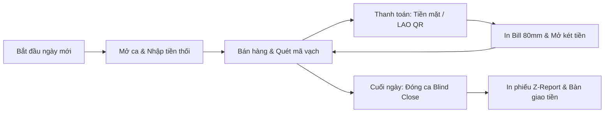
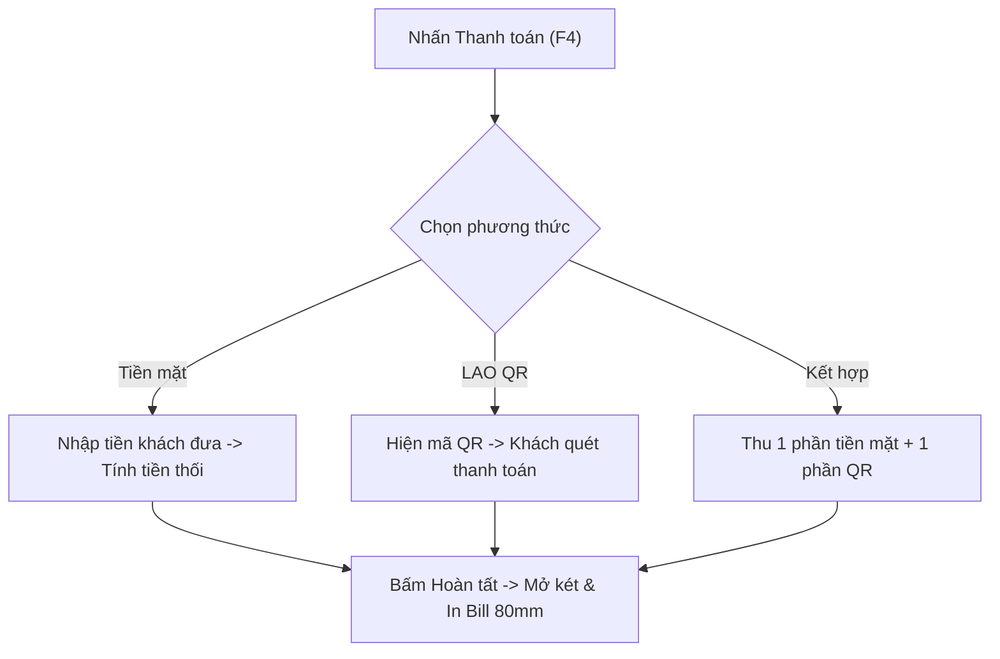

# TÀI LIỆU HƯỚNG DẪN SỬ DỤNG HỆ THỐNG QUICKONE POS
> **Hệ thống Quản lý Bán lẻ & Điểm bán hàng chuyên nghiệp cho Minimart / Siêu thị tiện lợi**  
> *Đơn vị tiền tệ chính: Kíp Lào (LAK - ₭) | Hỗ trợ màn hình cảm ứng POS 1366x768 & Khổ in nhiệt 80mm*

---

## MỤC LỤC
1. [Tổng quan Hệ thống & Thiết bị](#1-tổng-quan-hệ-thống--thiết-bị)
2. [Quy trình Quản lý Ca Bán Hàng (Cashier Shifts)](#2-quy-trình-quản-lý-ca-bán-hàng-cashier-shifts)
   - 2.1. Mở ca đầu ngày / đầu ca (Open Shift)
   - 2.2. Đóng ca kiểm ngân bảo mật (Blind Close Reconciliation)
   - 2.3. Xem kết quả đối soát & In phiếu tổng kết ca (Z-Report 80mm)
   - 2.4. Xử lý ca cũ bị treo (Stranded Shifts)
3. [Thao tác Bán hàng tại Quầy Thu ngân (POS Terminal)](#3-thao-tác-bán-hàng-tại-quầy-thu-ngân-pos-terminal)
   - 3.1. Quét mã vạch tự do (Global Hardware Scanner)
   - 3.2. Cơ chế chống lỗi bộ gõ bàn phím quốc tế
   - 3.3. Cú pháp nhân số lượng nhanh (`SốLượng*MãVạch`)
   - 3.4. Tìm kiếm & chọn món thủ công (Phím F1)
   - 3.5. Bán hàng theo Đơn vị quy cách (Thùng / Lốc / Hộp)
   - 3.6. Sản phẩm cân ký & Mã vạch cân điện tử (PLU Scale)
   - 3.7. Tạm lưu đơn & Phục hồi đơn (Hold Order - Phím F2)
   - 3.8. Quản lý giỏ hàng & Giảm giá (Discount)
4. [Quy trình Thanh toán & In Hóa đơn](#4-quy-trình-thanh-toán--in-hóa-đơn)
   - 4.1. Thanh toán Tiền mặt (Cash)
   - 4.2. Thanh toán Chuyển khoản LAO QR / OnePay
   - 4.3. Thanh toán Kết hợp (Mixed Payment)
   - 4.4. In hóa đơn nhiệt 80mm & Mở két tiền tự động
5. [Quản lý Sản phẩm & Đơn vị tính (Products & Packaging)](#5-quản-lý-sản-phẩm--đơn-vị-tính-products--packaging)
   - 5.1. Thêm mới sản phẩm & Tự sinh mã vạch chuẩn EAN-13
   - 5.2. Cấu hình đơn vị đóng gói (Lon $\rightarrow$ Lốc $\rightarrow$ Thùng)
   - 5.3. Cài đặt mặt hàng tươi sống cân ký
6. [Cấu hình Phần cứng & Thiết bị ngoại vi](#6-cấu-hình-phần-cứng--thiết-bị-ngoại-vi)
   - 6.1. Máy in hóa đơn nhiệt (LAN, Bluetooth, USB)
   - 6.2. Két đựng tiền thu ngân (Cash Drawer)
   - 6.3. Máy quét mã vạch (Barcode Scanner)
7. [Bảng Phím tắt Nhanh & Khắc phục sự cố thường gặp](#7-bảng-phím-tắt-nhanh--khắc-phục-sự-cố-thường-gặp)

---

## 1. TỔNG QUAN HỆ THỐNG & THIẾT BỊ

QuickOne POS là giải pháp phần mềm quản lý bán hàng chuyên dụng được tối ưu cho các minimart, cửa hàng tiện lợi và tạp hóa hiện đại:
- **Ngôn ngữ giao diện:** Hỗ trợ song ngữ chuẩn Tiếng Lào (`ພາສາລາວ`) và Tiếng Anh (`English`), phù hợp với nhân viên thu ngân bản địa.
- **Tiền tệ chuẩn:** Kíp Lào (LAK - `₭`), hiển thị phân cách hàng nghìn rõ ràng (ví dụ: `100.000 ₭`).
- **Khả năng hoạt động Ngoại tuyến (Offline-First):** Khi mất kết nối Internet, hệ thống tự động lưu trữ dữ liệu vào bộ nhớ cục bộ (Dexie Database) và tự động đồng bộ lên máy chủ Cloud (Supabase) ngay khi có mạng trở lại mà không làm gián đoạn việc bán hàng.
- **Tối ưu màn hình:** Giao diện được dàn trang chuẩn gọn cho màn hình cảm ứng POS độ phân giải phổ thông **1366x768**, không bị tràn khung hay khuất nút bấm.



---

## 2. QUY TRÌNH QUẢN LÝ CA BÁN HÀNG (CASHIER SHIFTS)
> *Đường dẫn trên menu:* **`ປະຫວັດບິນ & ກະ`** $\rightarrow$ **`ຄຸ້ມຄອງກະຂາຍເຄື່ອງ` (Quản lý ca)**

Quy trình quản lý ca chuẩn giúp cửa hàng kiểm soát chặt chẽ dòng tiền mặt, ngăn ngừa thất thoát và đối soát minh bạch giữa các thu ngân.

### 2.1. Mở ca đầu ngày / đầu ca (Open Shift)
Khi bắt đầu ca trực, thu ngân cần mở ca và khai báo số tiền mặt có sẵn trong két để thối tiền cho khách:
1. Nhấn nút **`ເປີດກະຂາຍເຄື່ອງໃໝ່ (Open Shift)`**.
2. Nhập số tiền thối ban đầu (**Opening Cash Float**). Thu ngân có thể bấm nhanh các nút chọn nhanh:
   - `200.000 ₭`
   - `300.000 ₭`
   - `500.000 ₭`
   - `1.000.000 ₭`
3. Nhập ghi chú (nếu có, ví dụ: *"Ca sáng - Thu ngân Somchai nhận ca"*).
4. Nhấn **`ຢືນຢັນເປີດກະ` (Xác nhận mở ca)**. Hệ thống sẽ kích hoạt ca bán hàng và cho phép bắt đầu tính tiền tại màn hình POS.

> [!IMPORTANT]
> **Quy tắc Ca duy nhất (Single Shift Rule):** Hệ thống chỉ cho phép duy nhất 1 ca bán hàng ở trạng thái mở tại một thời điểm để tránh trùng lặp doanh số.

---

### 2.2. Đóng ca kiểm ngân bảo mật (Blind Close Reconciliation)
Vào cuối ca trực, thu ngân tiến hành chốt ca. QuickOne POS áp dụng quy chuẩn **Blind Close** (Kiểm ngân mù): **Hệ thống ẩn doanh số bán trong ca để thu ngân đếm tiền độc lập, chống gian lận sửa số liệu**.

1. Tại thẻ ca đang mở, bấm nút **`ປິດກະ & ນັບເງິນ`**.
2. Hệ thống hiển thị Modal đếm tiền với **2 chế độ linh hoạt**:
   - **Chế độ 1 (Mặc định - `ນັບຕາມໃບເງິນ`):** Bố cục dạng lưới 2 cột đếm từng tờ tiền Kíp:
     - **Cột trái:** `100.000 ₭`, `50.000 ₭`, `20.000 ₭`, `10.000 ₭`
     - **Cột phải:** `5.000 ₭`, `2.000 ₭`, `1.000 ₭`, `500 ₭`
     - Sử dụng nút `+` / `-` hoặc gõ số lượng tờ tiền thực tế trong két. Hệ thống tự tính tổng tiền mặt.
   - **Chế độ 2 (`ປ້ອນຍອດລວມໂດຍກົງ`):** Nhập trực tiếp tổng tiền mặt đã đếm từ bên ngoài.
3. Nhập số tiền chuyển khoản ngân hàng thực tế thu được vào ô **`ຍອດໂອນ LAO QR`** (đối chiếu trên app ngân hàng).
4. Nhập ghi chú bàn giao (nếu có).
5. Nhấn nút **`ຢືນຢັນປິດກະ ແລະ ເບິ່ງຜົນ`** (Xác nhận đóng ca và xem kết quả đối soát).

---

### 2.3. Xem kết quả đối soát & In phiếu tổng kết ca (Z-Report 80mm)
Ngay sau khi bấm đóng ca, màn hình **Phiếu đối soát Z-Report** sẽ hiển thị kết quả kiểm ngân chi tiết:
- **Tiền đầu ca (Opening Cash):** Tiền thối mang vào lúc mở ca.
- **Doanh thu tiền mặt (Cash Sales):** Tổng tiền các đơn hàng thanh toán tiền mặt trong ca.
- **Tiền kỳ vọng (Expected Cash):** `Tiền đầu ca + Doanh thu tiền mặt`.
- **Tiền thực tế (Actual Cash):** Tiền thu ngân vừa đếm được.
- **Chênh lệch (Variance):**
  - **Màu xanh lục (Balanced):** Khớp tiền 100% (`0 ₭`), không thừa không thiếu.
  - **Màu hổ phách (Surplus):** Thừa tiền mặt (`+ ... ₭`).
  - **Màu đỏ (Shortage):** Thiếu tiền mặt (`- ... ₭`).
- **Nút in phiếu:** Nhấn **`ພິມໃບສະຫຼຸບປິດກະ (80mm)`** để in phiếu bàn giao ca Z-Report trên giấy in nhiệt 80mm, có đầy đủ chi tiết số lượng tờ tiền và phần ký tên bàn giao giữa Thu ngân và Quản lý.

---

### 2.4. Xử lý ca cũ bị treo (Stranded Shifts)
Nếu ca trước nhân viên quên đóng ca khiến ca bị treo:
- Trong bảng **Shift History**, ca bị treo sẽ có nhãn màu cam **`ກະຄ້າງ`**.
- Thu ngân hoặc Quản lý chỉ cần nhấn nút **`ປິດກະຄ້າງ`** trực tiếp tại dòng đó và xác nhận để đóng dứt điểm ca cũ mà không làm nghẽn hệ thống.

---

## 3. THAO TÁC BÁN HÀNG TẠI QUẦY THU NGÂN (POS TERMINAL)
> *Đường dẫn trên menu:* **`ລາຍໜ້າຮ້ານ (POS)`** *(Giao diện bán hàng chính)*

```
+-------------------------------------------------------------------------+
| [Header] QuickOne Logo | Bàn #1 | Nút Giữ đơn (F2)                      |
+-------------------------------------------------------------------------+
| [Thanh tìm kiếm & Quét mã vạch F1] [Nút quét Camera]                    |
+-------------------------------------------+-----------------------------+
| Danh mục: [Tất cả] [Nước ngọt] [Bia] ...  | GIỎ HÀNG (Cart)             |
|                                           |                             |
| +-------------------+ +-----------------+ | 1. Coca Cola Lon   x 2      |
| | Oishi Trà Xanh    | | Bia Lào Chai    | | 2. Bia Lào Thùng   x 1      |
| | 7.000 Kíp         | | 15.000 Kíp      | |                             |
| +-------------------+ +-----------------+ | Giảm giá:        -5.000 Kíp |
|                                           | TỔNG TIỀN:      125.000 Kíp |
|                                           | [ NÚT THANH TOÁN (F4) ]     |
+-------------------------------------------+-----------------------------+
```

### 3.1. Quét mã vạch tự do (Global Hardware Scanner)
- **Không cần click chuột:** Thu ngân cầm máy quét mã vạch và bóp cò quét bất kỳ lúc nào, sản phẩm sẽ tự động được tìm thấy và nhảy thẳng vào giỏ hàng kèm âm thanh *"Bíp"* dễ chịu.
- **Âm thanh phản hồi trực quan:**
  - Tiếng *"Bíp"* cao (Success): Đã quét đúng sản phẩm và thêm vào giỏ.
  - Tiếng *"Bzz"* thấp (Error): Không tìm thấy sản phẩm trong kho.

### 3.2. Cơ chế chống lỗi bộ gõ bàn phím quốc tế
Hệ thống QuickOne POS tích hợp sẵn công nghệ nhận diện phần cứng độc quyền:
- Dù máy tính thu ngân đang bật **tiếng Việt (Unikey/EVKey)**, **tiếng Thái (Kedmanee)**, **tiếng Lào** hay đang bị kẹt phím **Caps Lock / Shift**, khi quét mã vạch máy vẫn nhận diện chính xác dãy số `0-9` (ví dụ `8854698005050`) mà không bị lỗi thành các ký tự lạ như `**%$^(*))%)%` hay `๕๕๔๓ู๖๕๗`.
- Khi đang gõ tìm kiếm trong ô tìm kiếm mà quét mã, ô input sẽ hiển thị số sạch và tự động dọn sạch sau khi thêm món vào giỏ hàng thành công.

### 3.3. Cú pháp nhân số lượng nhanh (`SốLượng*MãVạch`)
Khi khách mua nhiều sản phẩm cùng loại (ví dụ 10 lon nước ngọt):
- Không cần quét 10 lần.
- Thu ngân chỉ cần gõ: `10*` rồi dùng máy quét bắn vào mã vạch lon nước.
- Hệ thống sẽ tự động thêm ngay 10 sản phẩm vào giỏ hàng trong 1 lần quét.

### 3.4. Tìm kiếm & chọn món thủ công (Phím F1)
- Nhấn phím **`F1`** trên bàn phím: Con trỏ chuột sẽ tự động nhảy vào ô tìm kiếm.
- Thu ngân có thể gõ tên món bằng tiếng Lào, tiếng Việt hoặc tiếng Anh (ví dụ: *"Beer"*, *"Pepsi"*, *"ນ້ຳ"*).
- Bấm vào thẻ sản phẩm trên màn hình cảm ứng để thêm món vào giỏ.

### 3.5. Bán hàng theo Đơn vị quy cách (Thùng / Lốc / Hộp)
Đối với các mặt hàng có quy cách đóng gói (như Nước ngọt, Bia, Sữa):
- Trên thẻ sản phẩm có hiển thị nút chuyển đơn vị nhanh: **`ອັນ (Lon/Chai)`** hoặc **`ແພັກ/ແກັດ (Lốc/Thùng)`**.
- Mỗi đơn vị có giá bán và mã vạch riêng biệt. Khi khách mua cả thùng, thu ngân quét mã vạch trên thùng thì hệ thống sẽ tự tính đúng giá thùng và tự trừ tồn kho tương ứng.

### 3.6. Sản phẩm cân ký & Mã vạch cân điện tử (PLU Scale)
Đối với hàng tươi sống, rau củ quả, thịt cá cân ký:
- QuickOne POS hỗ trợ chuẩn mã vạch cân điện tử quốc tế **EAN-13 (Đầu số 20 - 29)**.
- Khi quét tem nhãn in ra từ cân điện tử, hệ thống tự động nhận diện mã hàng (PLU) và tự động tính đúng khối lượng (Kg) hoặc số tiền cân mà thu ngân không cần gõ tay.

### 3.7. Tạm lưu đơn & Phục hồi đơn (Hold Order - Phím F2)
Khi khách đang tính tiền nhưng quên đồ và quay lại lấy thêm, để không làm nghẽn hàng đợi của khách phía sau:
1. Nhấn phím **`F2`** (hoặc nút **`+ ພັກບິນ (F2)`** trên thanh tiêu đề).
2. Toàn bộ giỏ hàng của khách hiện tại sẽ được tạm lưu an toàn.
3. Màn hình giỏ hàng trở về trống để thu ngân tính tiền cho khách tiếp theo.
4. Khi khách quay lại, nhấn vào danh sách đơn tạm lưu để nạp lại đơn cũ và tiếp tục thanh toán.

### 3.8. Quản lý giỏ hàng & Giảm giá (Discount)
- **Tăng / Giảm số lượng:** Nhấn nút `+` hoặc `-` trực tiếp trên từng dòng món trong giỏ hàng.
- **Xóa món:** Nhấn biểu tượng thùng rác màu đỏ trên dòng món cần xóa.
- **Giảm giá đơn hàng:** Nhấn nút **`ສ່ວນຫຼຸດ (Discount)`** để áp dụng giảm theo số tiền Kíp hoặc theo phần trăm `%`.

---

## 4. QUY TRÌNH THANH TOÁN & IN HÓA ĐƠN

Sau khi kiểm tra giỏ hàng, nhấn nút lớn màu xanh lục **`ຊຳລະເງິນ (Thanh toán)`** hoặc nhấn phím tắt **`F4`** / **`Space`** để mở cửa sổ thanh toán.



### 4.1. Thanh toán Tiền mặt (Cash)
1. Chọn tab **`ເງິນສົດ (Tiền mặt)`**.
2. Nhập số tiền khách đưa (có các nút gợi ý tiền chẵn nhanh: `50.000`, `100.000`, `500.000`).
3. Hệ thống hiển thị số **Tiền thừa trả khách** (`ເງິນທອນ`) to rõ màu xanh.
4. Nhấn **`ຢືນຢັນການຊຳລະ (Xác nhận thanh toán)`**.

### 4.2. Thanh toán Chuyển khoản LAO QR / OnePay
1. Chọn tab **`ໂອນເງິນ / LAO QR`**.
2. Màn hình hiển thị mã QR động chứa đúng số tiền cần thanh toán.
3. Khách hàng dùng app ngân hàng (BCEL One, Phongsavanh, v.v.) quét mã QR.
4. Thu ngân xác nhận tiền đã vào tài khoản và bấm **`ຢືນຢັນຊຳລະແລ້ວ`**.

### 4.3. Thanh toán Kết hợp (Mixed Payment)
Áp dụng khi khách trả một phần tiền mặt và phần còn lại quét mã QR:
1. Chọn tab **`ແບ່ງຈ່າຍ (Mixed)`**.
2. Nhập số tiền mặt khách trả trước $\rightarrow$ hệ thống tự tính số tiền còn lại chuyển sang mã QR.

### 4.4. In hóa đơn nhiệt 80mm & Mở két tiền tự động
- Ngay sau khi bấm xác nhận thanh toán thành công:
  - Máy in nhiệt 80mm sẽ tự động in hóa đơn bán lẻ (Bill).
  - Tín hiệu kích mở két tự động bật mở ngăn kéo đựng tiền để thu ngân cất tiền và trả tiền thừa.
- **Nội dung Bill 80mm chuẩn:**
  - Tên cửa hàng: **QuickOne POS SYSTEM**
  - Địa chỉ: **ປາກຊອງ, ຈຳປາສັກ (Paksong, Champasak)** | Hotline: **55257555**
  - Chi tiết từng món, đơn giá, số lượng, giảm giá, tiền khách đưa, tiền thừa.
  - Lời cảm ơn và mã vạch hóa đơn để tra cứu khi đổi trả.

---

## 5. QUẢN LÝ SẢN PHẨM & ĐƠN VỊ TÍNH (PRODUCTS & PACKAGING)
> *Đường dẫn trên menu:* **`ສິນຄ້າ & ຫົວໜ່ວຍ` (Sản phẩm & Đơn vị)**

### 5.1. Thêm mới sản phẩm & Tự sinh mã vạch chuẩn EAN-13
1. Bấm nút **`+ ເພີ່ມສິນຄ້າໃໝ່ (Thêm sản phẩm)`**.
2. Nhập thông tin:
   - **Tên sản phẩm:** Nhập tên rõ ràng (ví dụ: *"Oishi Trà Xanh 500ml"*).
   - **Danh mục:** Chọn nhóm hàng (Đồ uống, Bánh kẹo, Gia vị, v.v.).
   - **Mã vạch (Barcode):** 
     - Dùng máy quét bắn vào mã vạch có sẵn trên bao bì sản phẩm.
     - HOẶC nhấn nút **`ສ້າງບາໂຄດ (Auto Generate)`** để hệ thống tự cấp một mã EAN-13 hợp chuẩn quốc tế nếu mặt hàng không có sẵn mã vạch.
   - **Giá vốn (Cost Price):** Giá nhập vào từ nhà cung cấp.
   - **Giá bán lẻ (Selling Price):** Giá bán cho khách lẻ $\rightarrow$ Hệ thống tự tính tỷ lệ phần trăm lợi nhuận (**Margin %**).
3. Bấm **`ບັນທຶກ (Lưu sản phẩm)`**.

### 5.2. Cấu hình đơn vị đóng gói (Lon $\rightarrow$ Lốc $\rightarrow$ Thùng)
QuickOne POS hỗ trợ quản lý quy cách 2 tầng chuyên nghiệp:
- **Đơn vị cơ sở:** Ví dụ: `Lon` (giá lẻ 10.000 ₭).
- **Đơn vị quy cách (Pack Unit):** Bật công tắc thêm đơn vị Thùng/Lốc:
  - Chọn tên: `Thùng` (`ແກັດ`).
  - Hệ số quy đổi: `24` (1 thùng = 24 lon).
  - Giá bán thùng: Nhập giá ưu đãi (ví dụ: `220.000 ₭` thay vì 240.000 ₭) $\rightarrow$ Hệ thống tự tính số tiền tiết kiệm cho khách hàng.
  - Mã vạch thùng: Quét mã vạch in bên ngoài vỏ thùng carton.

---

## 6. CẤU HÌNH PHẦN CỨNG & THIẾT BỊ NGOẠI VI
> *Đường dẫn trên menu:* **`ຕັ້ງຄ່າ & ພະນັກງານ` $\rightarrow$ `ຕັ້ງຄ່າເຄື່ອງພິມ (Cài đặt máy in)`**

### 6.1. Máy in hóa đơn nhiệt (Thermal Receipt Printer)
- **Chuẩn giấy:** Khuyên dùng khổ **80mm** (độ rộng in khả dụng 72mm - 576 dots) cho hóa đơn rõ nét và chuyên nghiệp nhất.
- **Loại kết nối hỗ trợ:**
  - **Mạng LAN / Wifi (Khuyên dùng cho quầy thu ngân cố định):** Nhập địa chỉ IP máy in (ví dụ: `192.168.1.200`) và cổng Port `9100`. In cực nhanh, không phụ thuộc dây nối máy tính.
  - **Bluetooth:** Phù hợp cho thiết bị máy POS cầm tay Android.
  - **USB / Trình duyệt:** Kết nối trực tiếp máy tính qua cổng USB và in qua Windows Driver.
- **Chế độ in:** 
  - `Tự động in bill sau khi thanh toán`: Bật để máy tự in không cần hỏi.
  - `Hỏi trước khi in`: Hiện hộp thoại hỏi khách có cần lấy hóa đơn không.

### 6.2. Két đựng tiền thu ngân (Cash Drawer)
- Két tiền kết nối với máy in nhiệt qua dây cáp điện thoại RJ11.
- Trong phần cài đặt phần cứng:
  - Bật tùy chọn **`Tự động mở két khi thanh toán`** (`Auto Open Drawer`).
  - Chọn chân kích ngăn kéo: **Pin 2** (mặc định đa số các dòng máy POS) hoặc **Pin 5**.

### 6.3. Máy quét mã vạch (Barcode Scanner)
- Tương thích 100% với mọi loại máy quét mã vạch 1D và 2D (Datalogic, Honeywell, Sunmi, Netum, Zebex, v.v.) cắm qua cổng USB hoặc Bluetooth.
- Không cần cài đặt driver đặc biệt (Plug & Play).

---

## 7. BẢNG PHÍM TẮT NHANH & KHẮC PHỤC SỰ CỐ THƯỜNG GẶP

### 7.1. Bảng phím tắt thao tác nhanh trên bàn phím POS

| Phím tắt | Chức năng | Mô tả chi tiết |
| :---: | :--- | :--- |
| **`F1`** | **Tìm kiếm / Quét mã vạch** | Đưa nhanh con trỏ chuột vào thanh tìm kiếm sản phẩm |
| **`F2`** | **Tạm lưu đơn (Hold Order)** | Tạm lưu đơn hàng hiện tại để phục vụ khách kế tiếp |
| **`F4`** hoặc **`Space`** | **Thanh toán (Checkout)** | Mở nhanh cửa sổ thanh toán tiền mặt / chuyển khoản QR |
| **`Esc`** | **Hủy / Đóng cửa sổ** | Đóng popup đang mở hoặc xóa nhanh nội dung tìm kiếm |
| **`<Số>*<Barcode>`** | **Nhân số lượng nhanh** | Ví dụ gõ `5*` rồi quét mã vạch để thêm ngay 5 món |

---

### 7.2. Hướng dẫn Khắc phục sự cố thường gặp (Troubleshooting)

#### 1. Quét mã vạch nhưng nghe tiếng "Bzz" và báo không tìm thấy sản phẩm?
- **Nguyên nhân:** Sản phẩm chưa được khai báo mã vạch trong kho hoặc mã vạch trên vỏ hộp bị mờ/rách.
- **Xử lý:** Nhấn phím `F1`, gõ tên sản phẩm để tìm và bán thủ công. Sau ca bán hàng, vào mục `ສິນຄ້າ & ຫົວໜ່ວຍ` để cập nhật lại mã vạch cho sản phẩm đó.

#### 2. Máy quét mã vạch bị gõ ra chữ lạ khi đang bật Unikey / Tiếng Thái?
- **Yên tâm:** Bản cập nhật QuickOne POS đã tích hợp bộ giải mã phần cứng tự động sửa lỗi. Dù bàn phím hiển thị ký tự gì, hệ thống vẫn tự động chuyển về đúng số `0-9` và thêm món vào giỏ hàng bình thường.

#### 3. Máy in không in ra giấy sau khi thanh toán?
- Kiểm tra nguồn điện máy in và đảm bảo nắp máy in đã đóng chặt.
- Kiểm tra giấy in còn hay hết (đèn đỏ `Error` hoặc `Paper Out` sáng nghĩa là hết giấy).
- Nếu dùng máy in mạng LAN: Kiểm tra dây mạng cắm vào máy in và đảm bảo máy POS đang kết nối cùng mạng Wifi với máy in.

#### 4. Đột ngột mất kết nối mạng Internet có bán hàng được không?
- **Hoàn toàn bình thường:** QuickOne POS hoạt động độc lập trên cơ sở dữ liệu nội bộ (Offline Dexie). Quầy thu ngân vẫn quét mã, tính tiền, mở két và in bill bình thường. Khi có mạng trở lại, hệ thống sẽ tự động đồng bộ tất cả đơn hàng lên Cloud.

---

> [!TIP]
> **Hỗ trợ Kỹ thuật & Bảo hành:**
> - Trung tâm hỗ trợ: **QuickOne POS Support Team**
> - Hotline kỹ thuật: **55257555**
> - Địa chỉ cửa hàng mẫu: **ປາກຊອງ, ຈຳປາສັກ (Paksong, Champasak, Laos)**
